= Select the Windows or the Linux build
:url-umu: https://github.com/Open-Wine-Components/umu-launcher
:url-lutris: https://lutris.net/
:url-bottles: https://usebottles.com/
ifdef::env-github[]
:tip-caption: :bulb:
:note-caption: :paperclip:
endif::[]

Sweet Launcher has two builds: Linux and Windows.
This guide helps you to select the correct build for your system.

* *Linux build*: you run `sweet` natively. The launcher starts the game client with UMU.
* *Windows build*: you run `sweet.exe` with Proton 10+ via a launcher: Steam, UMU, {url-lutris}[Lutris], {url-bottles}[Bottles], etc.

TIP: In short, if {url-umu}[UMU] is installed, works, and you are familiar with Linux, we recommend using the Linux build.
If you cannot, or you don't want to install UMU, use the Windows build.

== Step-by-step guide

// Run `make docs` to update the image.

== Pros and cons

[cols="1h,3,3"]
|===
| | Linux build | Windows build

| Pros
a|
* It runs natively.
* It is the easier option when UMU is installed and works.
* It gives you fine control over the installation and runtime (WinePrefix, UMU GameId, UMU ProtonPath, MangoHud and Proton settings).
* You can use any Proton version to run the client.
a|
* It is the easier option when UMU is not installed.
* It works with the Proton launcher that you use now. For example, Steam.

| Cons
a|
* You must install UMU. And optionally MangoHud, if you want to use it.
a|
* You must set up a Proton10 environment for `sweet.exe`.
* The internal config database is harder to access (inside the Wine prefix).
* It gives you less control over the installation and runtime.
* You must use the same Proton version for Sweet and the game client.
|===

== Next steps

* link:../README.adoc#linux-build[Getting Started with the Linux build]
* link:../README.adoc#windows-build[Getting Started with the Windows build]
